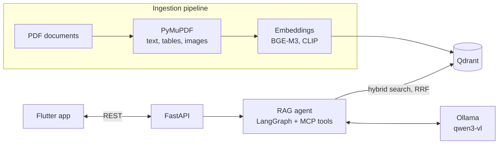

# EMSI ChatBot

An AI assistant for EMSI students, delivered as a Flutter mobile app. It answers questions about the school, such as programs, admissions and campus life, using EMSI's official documents as its only source of truth. Answers come with page-level citations.

The back-end is an **agentic multimodal RAG** (Retrieval-Augmented Generation) system that runs entirely on local infrastructure: no data leaves the machine.

## Architecture



- **Ingestion:** documents are split into text, table and image chunks, embedded with BGE-M3 (text) and CLIP (images), and stored in Qdrant with their page metadata.
- **Retrieval:** each question runs text and image searches in parallel; Reciprocal Rank Fusion merges the results.
- **Generation:** a local vision-language model answers from the retrieved context, citing its sources.
- **Agentic mode:** an LLM agent decides which tools to call (search text, search images, read a page) in a ReAct loop and keeps per-conversation memory.

## Tech stack

| Layer | Technology |
| --- | --- |
| Mobile client | Flutter |
| API | FastAPI |
| Vector database | Qdrant |
| Document extraction | PyMuPDF |
| Embeddings | BGE-M3, CLIP ViT-B/32 |
| Language model | qwen3-vl (Ollama) |
| Agent framework | LangChain, LangGraph, Model Context Protocol |

## Repository structure

```text
emsi-chatbot-rag/
├── backend/      Python services: ingestion, retrieval, API, agent
└── mobile_app/   Flutter client
```

## Getting started

### Prerequisites

- Flutter SDK 3.x
- Python 3.12 or later
- Docker Desktop
- Ollama 0.12.7 or later
- An NVIDIA GPU with 8 GB of VRAM or more is recommended

### Services

```bash
docker compose up -d          # Qdrant on http://localhost:6333
ollama pull qwen3-vl:4b       # local vision-language model
```

### Backend

```bash
cd backend
python -m venv .venv
.venv\Scripts\activate            # on macOS/Linux: source .venv/bin/activate
pip install -r requirements.txt
```

Place the PDF documents in `backend/data/`, then build the vector index:

```bash
python ingest.py
```

Start the API (interactive documentation at http://localhost:8000/docs):

```bash
uvicorn api:app --host 0.0.0.0 --port 8000
```

### Mobile app

```bash
cd mobile_app
flutter pub get
flutter run
```

## Author

Ilyass Hakim, EMSI
